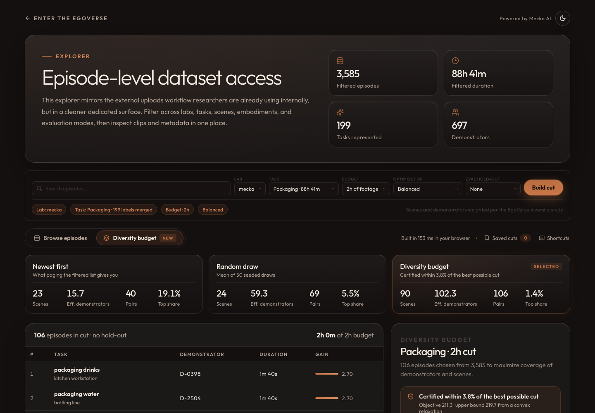

# Diversity budget for the EgoVerse explorer

**Live demo:** https://mohith26.github.io/mecka-diversity-budget/

A concept feature for Mecka's [EgoVerse explorer](https://partners.mecka.ai/egoverse): pick a task family and an hour budget, and it returns the episodes that cover the most demonstrators and scenes for that budget, with a certificate saying how far the cut can be from the best possible one. The EgoVerse paper found that demonstrator diversity drives generalization to unseen people and scene diversity drives generalization to new environments, especially at small data budgets; today the explorer (and the research workbench's dataset builder) can filter, page and split, but nothing chooses *which* hours to take. On Mecka's own public EgoVerse rows (41,617 episodes, 828 hours), a 2-hour Packaging cut covers **90 scenes instead of 24** for a random draw of the same hours, and is certified within **3.83%** of the optimum.

## What it does

- **Diversity budget view** next to the explorer's episode table: task family, budget (1, 2, 4, 8 or 16 hours, up to half the footage in the family), what to optimize for (unseen demonstrators, novel environments, or balanced), and an optional held-out set of demonstrators for an unseen-demonstrator eval split (the paper's protocol).
- **Same budget, three ways to fill it:** newest first (what paging the filtered list gives you), a random draw (mean of 50 seeded draws), and the diversity cut, compared on scenes, effective demonstrators (Hill number, exp of Shannon entropy over minutes), demonstrator-scene pairs and the largest single demonstrator's share.
- **Drill-down:** every pick shows the real clip (streamed from the explorer's public video endpoint), its subtask segments and objects, and *why it is in the cut*: the marginal gain split into new demonstrator, new scene, new pair and new task label at the moment it was added.
- **Actions:** export the cut as CSV or as a JSON manifest (train hashes, eval hashes, weights, certificate, baselines), save cuts locally, copy a deep link. A "Capture next" list ranks scenes the cut has exhausted by how much diversity a new demonstrator's minute there would add, which is the input a capture-ops team needs; the full ranking exports as CSV.
- Deep links (`#family=packag&h=2&obj=balanced&hold=0&view=cut&ep=...`), localStorage for saved cuts and the last view, light and dark themes from the explorer's own tokens, keyboard shortcuts (`j/k`, `Enter`, `Esc`, `/`, `b`, `v`, `e`, `s`, `[ ]`, `?`), loading, empty and error states.

## How it works

The objective is a sum of concave functions of footage per group:

    f(S) = sum over g in (demonstrator, scene, demonstrator x scene, task label) of  w_g * sum_k log(1 + T_k(S) / 60 s)

where `T_k(S)` is the seconds of footage in the cut that belong to group `k`. The first minute of a new demonstrator or scene is worth the most; more minutes of the same one have diminishing returns. A concave function of a modular function is submodular, so:

1. **Selection.** Lazy (CELF) greedy by gain per second under the knapsack budget, a plain-gain greedy pass, best of the two, then a remove-one/add-one swap search with greedy refill (strict improvements only).
2. **Certificate.** Every episode is atomic, so each group total is either 0 or at least the group's shortest episode `m_k`. Replacing `log(1 + t/tau)` by its chord on `[0, m_k]` gives a concave function that equals `f` at every reachable integral point, so its maximum over the relaxed budget polytope bounds the best integral cut. Frank-Wolfe with exact line search bounds that maximum through its duality gap (the linear step is a fractional knapsack). Without the chord the relaxation splits episodes into slivers and the bound is 15-25% looser. The page reports `1 - f(S) / bound`.
3. **Baselines** use the same fill rule (take episodes in order while they fit). Random is averaged over 50 seeded shuffles.

Everything runs in the browser in roughly 50-250 ms per build (`src/diversity.js`, no dependencies). `scripts/report.mjs` recomputes all 261 configurations into `results/results.json`, and the tests check that the page's headline matches it.

## Results (2-hour budget, balanced objective)

Across the 23 families with labeled scenes, the cut covers 47.8 scenes on average against 19.6 for a random draw (2.37x), and 91 effective demonstrators against 49. It beats the 95th-percentile random draw on scenes in 23 of 23 families. Certified gap: median 3.6%, max 5.52%; over all 261 configurations the largest gap is 7.97%.

| Task family | Hours available | Scenes: newest / random / cut | Effective demonstrators: random / cut | Top demonstrator share: random / cut | Certified gap |
|---|---:|---:|---:|---:|---:|
| Cleaning | 89.5 | 30 / 31.9 / **105** | 70.9 / **110** | 3.9% / 1.3% | 4.6% |
| Packaging | 88.7 | 23 / 24.0 / **90** | 59.3 / **102.3** | 5.5% / 1.4% | 3.8% |
| Assembling | 54.8 | 18 / 27.8 / **80** | 50 / **99.6** | 8.6% / 1.9% | 4.6% |
| Sorting | 34.0 | 11 / 32.4 / **75** | 44.4 / **96.5** | 8.0% / 1.9% | 3.9% |
| Folding | 27.3 | 5 / 26.1 / **64** | 60.3 / **99.6** | 5.3% / 2.1% | 4.2% |
| Cutting | 27.2 | 18 / 29.8 / **75** | 52.6 / **95.6** | 6.3% / 2.1% | 3.6% |
| Making | 22.1 | 20 / 23.0 / **58** | 53.7 / **89.8** | 5.7% / 2.3% | 3.4% |
| Dishwashing | 22.0 | 7 / 4.7 / **13** | 75 / **103.4** | 3.4% / 2.1% | 2.4% |
| Repairing | 19.4 | 8 / 9.1 / **27** | 46.8 / **94.3** | 8.6% / 2.1% | 4.5% |
| Potting | 19.3 | 13 / 8.9 / **20** | 35.1 / **91.1** | 12.8% / 1.5% | 5.5% |
| Filling | 19.0 | 16 / 23.6 / **53** | 51.1 / **95.5** | 6.8% / 2.3% | 3.2% |
| Organizing | 16.8 | 21 / 28.6 / **73** | 59.2 / **95.5** | 7.1% / 1.7% | 3.5% |
| Sharpening | 14.7 | 12 / 12.2 / **19** | 74.5 / **102.1** | 3.2% / 1.4% | 3.6% |
| Ironing | 14.6 | 3 / 10.0 / **20** | 16.8 / **57.5** | 19.5% / 4.2% | 0.9% |
| Shaping | 12.8 | 9 / 12.9 / **28** | 29.7 / **92.2** | 14.7% / 2.1% | 3.7% |
| Crafting | 12.5 | 13 / 18.4 / **40** | 45.5 / **74.6** | 6.3% / 2.8% | 5.4% |
| Preparing | 12.4 | 22 / 29.1 / **64** | 63.9 / **96.4** | 6.1% / 1.7% | 1.9% |
| Wrapping | 11.6 | 12 / 19.2 / **43** | 51.8 / **93.8** | 5.3% / 2.3% | 4.7% |
| Packing | 11.5 | 27 / 22.8 / **46** | 52.2 / **96.7** | 6.0% / 2.2% | 3.4% |
| Mixing | 10.5 | 9 / 13.2 / **26** | 21.9 / **70.7** | 13.3% / 2.5% | 1.7% |
| Bottling | 10.2 | 7 / 7.3 / **16** | 21.9 / **54.5** | 16.3% / 4.2% | 1.6% |
| Disassembling | 9.9 | 9 / 10.3 / **18** | 39.1 / **91.7** | 9.8% / 2.2% | 5.0% |
| Cup on saucer | 8.4 | 0 / 0.0 / **0** | 16.3 / **21.2** | 12.3% / 5.1% | 0.0% |
| Arranging | 7.8 | 15 / 26.3 / **46** | 52.3 / **89** | 6.2% / 2.3% | 2.0% |

Cup on saucer has no scene labels in this snapshot, so only demonstrators and task labels count there.

## Data

`scripts/fetch.mjs` pulls the `lab = mecka` rows (episode hash, operator, task, description, scene, objects, frames, created_at, segments) from the public, read-only EgoVerse research workbench API, which reads the same EgoVerse PostgreSQL the explorer browses. `scripts/build_data.mjs` keeps the 24 task families with at least 4 hours and 20 demonstrators (30,875 episodes), pseudonymizes operator ids to `D-0001...` and writes `data/episodes.json` plus per-family annotation files. Snapshot date is in `data/FETCHED_AT`. Raw pages are not committed.

## Run it

    node scripts/fetch.mjs        # optional: refresh the snapshot (about 7 minutes, 417 requests)
    node scripts/build_data.mjs
    node scripts/report.mjs
    node --test test/diversity.test.mjs
    python3 -m http.server 8000  # then open http://localhost:8000

No build step; the page is static HTML, CSS and ES modules. The CI workflow is in `ci/test.yml` (move it to `.github/workflows/` to activate; the publishing token here lacks the `workflow` scope).

## Tests

15 tests in `test/diversity.test.mjs`, including: certified bounds never below the brute-force optimum on 150 random coarse instances (all three objectives); within 1% of the brute-force optimum on average in the many-episodes-per-budget regime; submodularity on 300 random chains; budget respected and objective equal to the sum of accepted gains on real families; held-out demonstrators never leak into the cut; capture-plan exhaustion is correct; every committed configuration beats both baselines; and the headline (Packaging, 2 h: 90 scenes, gap 3.83%) recomputed from the snapshot.

## Limitations

- The objective is a proxy. The EgoVerse study shows demonstrator and scene diversity help transfer; it does not say these weights or this log shape are optimal. Nothing here trains a policy, so the cut is not shown to improve success rates.
- Scene labels are free text from upload metadata, so near-duplicates ("tea production" and "tea production room") count as different scenes, and 14% of Mecka rows have no scene. Label canonicalization would make the scene numbers more honest.
- Metadata only: it does not look at video, so it cannot catch visually redundant episodes or bad captures.
- The certificate is an upper bound from a relaxation; the true gap is usually smaller. On tiny, coarse instances (a handful of long episodes per budget) the greedy can be well short of optimal; the test suite measures this.
- Task families come from stemming the first word of the task label, which merges `fold_clothes` and `folding_clothes` but cannot merge synonyms.
- The capture plan is first-order (value of one new minute from a new demonstrator), not a full collection schedule.
- Snapshot of public rows on 2026-11-11; not live.

## Prior art and what is new

Diversity and coverage-based subset selection is well studied: submodular data subset selection (Wei, Iyer and Bilmes, ICML 2015), core-sets for active learning (Sener and Savarese, ICLR 2018), budgeted submodular maximization with cost-benefit greedy (Khuller, Moss and Naor 1999; Leskovec et al. CELF and its online bound, KDD 2007), and embedding-based diversity sampling in data-curation tools such as Lightly and Encord. The EgoVerse paper balanced minutes per demonstrator-scene pair by hand for its scaling study. What is new here is applying a budgeted, certified version of this to episode metadata in the explorer itself: demonstrator, scene and pair coverage under an hour budget with a held-out eval split, a per-episode explanation, and a tighter integrality-aware relaxation bound. I found no budgeted or diversity-aware selection in the EgoVerse explorer, the research workbench's dataset builder (random or group splits), the EgoVerse repo, or Mecka's site and announcements as of November 2026.

---
Unofficial concept demo by Mohith Gajjela. Not affiliated with Mecka. Public data from the EgoVerse database (Mecka lab rows); demonstrator ids pseudonymized. Code under the MIT license.
